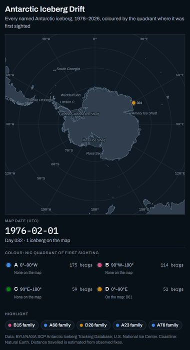

# Antarctic Iceberg Drift

Every named Antarctic iceberg tracked by BYU's scatterometer database and the U.S. National Ice Center, animated on a polar map from 1976 to 2026. Positions are only ever real reported fixes.

<p align="center"></p>

**Page:** open `docs/index.html` in a browser. It is self-contained apart from one pinned library (proj4js 2.11.0 from cdnjs) and Google Fonts.

The record covers **400 named icebergs** and **334,328 position fixes**.
- On 15 Oct 2026 the map shows 34 bergs, the same count as the U.S. National Ice Center's list for that day.
- Colour marks the NIC quadrant where each berg was first sighted.
- Past tracks stay on the map as faint traces.
- The five families from the original brief (A68, A23, B15, A76, D28) can be highlighted, and their labels show distance travelled.

## How it works

1. `scripts/download.sh` fetches the BYU consolidated iceberg database, every USNIC weekly iceberg CSV since Nov 2014 (`scripts/fetch_usnic.py`), and Natural Earth land and ice shelves.
2. `scripts/build.sh` runs:
   - `usnic_extract.py`: one long table from the weekly files.
   - `build_dataset.py`: merging, QC flags, distance travelled.
   - `build_coast.py`: clips the coastline.
   - `pack_data.py`: compact JSON for the page.
   - `build_html.py`: injects everything into `src/template.html` and writes `docs/index.html`.
   - It also writes `data/iceberg_tracks.csv` and `data/sources_per_berg.csv`.
3. `scripts/export.py` + `scripts/encode.py` use the same method as [sao-paulo-em-movimento](https://github.com/michelkluger/sao-paulo-em-movimento):
   - Playwright opens the page in a portrait video layout and steps it through `window.__seek`, one frame per 10 simulated days.
   - Four workers split the frames, and an interrupted run resumes.
   - ffmpeg encodes a 1080×1920 MP4 and a GIF.

```sh
sh scripts/download.sh
sh scripts/build.sh

# optional: video export (uses Edge by default; PW_CHANNEL=chrome or "" for bundled Chromium)
for k in 0 1 2 3; do uv run --with playwright python scripts/export.py docs/index.html frames dark 10 $k 4 & done; wait
uv run --with imageio-ffmpeg python scripts/encode.py frames out/antarctic-iceberg-drift 0x0a1118
# lighter GIF for this README: every 6th frame, 380 px wide
uv run --with imageio-ffmpeg python scripts/encode.py frames media/preview 0x0a1118 6 380 gif_only
```

The full export is 1,912 frames: one per 10 days from 1 Feb 1976 to 15 Oct 2026, plus 2 s held on the last day. It gives a 64 s MP4 (14 MB) and a 32 s GIF (13 MB).

## Method

- **Named bergs only.** A NIC designation is the quadrant letter, a number, and fragment letters:

  | Letter | Longitudes | Region |
  |---|---|---|
  | A | 0°–90°W | Weddell and Bellingshausen seas |
  | B | 90°W–180° | Amundsen Sea and eastern Ross Sea |
  | C | 90°E–180° | western Ross Sea and Wilkes Land |
  | D | 0°–90°E | Amery Ice Shelf and eastern Weddell Sea |

  BYU's 267 unnamed tracks (`sa`, `e`, `uk` files) are left out.
- **Observed fixes only.** BYU's README defines `<sensor>_3` as 1 for an observation and 0 for an interpolated day. The 90,067 interpolated rows are dropped.
- **One fix per berg per day.**
  - Priority: ASCAT > QuikSCAT > OSCAT > SeaWinds > NSCAT > ERS > SASS, then NIC only on days with no scatterometer fix.
  - Reason: NIC fixes in the BYU files are sometimes stale or have a flipped longitude sign.
- **USNIC rows.** Deduplicated on "Last Update" and appended after a berg's last BYU date. 20 bergs exist only in USNIC. Where BYU's NIC column and USNIC share a date they agree within 1.1 km for 95% of 18,747 pairs.
- **No interpolation on the map.**
  - A marker sits at its latest fix.
  - A line joins two fixes only when they are at most 10 days apart.
  - The marker becomes a dashed ring after 10 days without a fix and is hidden after 90 days.
- **Marker size is area, not mass.**
  - Area comes from USNIC's reported area where given (from Apr 2024). Otherwise it is π/4 × length × width from NIC dimensions in nautical miles; NIC rounds to whole nautical miles.
  - For the ten bergs on BYU's all-time size ranking, their maximum size is used before their first NIC dimensions.
  - Size falls when a berg breaks up or wastes at its edges. Thinning, a large part of mass loss, is in neither source, so mass is not shown.
  - The tooltip gives the area change since the first area of the same kind.
- **Distance travelled (`km_travelled`).** A running estimate per berg: great-circle steps between successive fixes.
  - Steps count only between fixes from the same sensor, because NIC and the scatterometers place a berg's centre up to tens of km apart.
  - A step counts only once the berg is more than 10 km from the last counted point (ASCAT pixels are 4.45 km).
  - Spikes are skipped, jumps add nothing, and each fragment starts at 0.
  - Accuracy is rough. Noise adds about 45 km a year to a stationary berg (A23a, grounded 1992–2019: about 1,300 km). Other reasonable rules give totals up to 25% lower (A68a: about 4,040 km with this rule, 3,100 km with weekly sampling).

## Quality control

All checks use 100 km/day as the speed limit. Nothing is deleted; flags are in `qc_flag`.

- **29 fixes north of 45°S** are flagged but drawn, since they belong to consistent tracks:
  - C19c in Mar 2013: ASCAT, to 44.4°S near Greenwich.
  - A57a in Jul–Aug 2019: NIC, to 42.57°S.

  The map reaches about 44°S on its axes to keep them in frame.
- **97 spikes.** A fix that disagrees with most fixes within ±5 days, or a short excursion the track returns from. Spikes are hidden from tracks.
- **175 jumps.** A step over 100 km/day that isn't an isolated spike. The line breaks there.

## Caveats

- **Scatterometer era.** Scatterometers miss bergs in summer melt and lose contrast near ice; NIC reports before the 1990s are sparse, so early tracks are mostly dots.
- **A23B is two bergs.** NIC reused the name: BYU's A23B is a 1991–1999 piece of A23, and USNIC's A23B is a 2025 piece of A23A.
- **A23a has no fix after 31 Mar 2026.**
- **Missing week.** The USNIC file for 28 Aug 2020 returns HTTP 404.

## Data (accessed 2026-10-16)

- **BYU/NASA Scatterometer Climate Record Pathfinder**, [Antarctic Iceberg Tracking Database](https://www.scp.byu.edu/data/iceberg/database1.html), consolidated v8.0 ([zip](https://www.scp.byu.edu/data/iceberg/consolidated_database_v8.0.zip), files dated 2026-05-08).
- **U.S. National Ice Center**, [Antarctic iceberg weekly CSV archive](https://usicecenter.gov/Products/ArchiveSearchMulti?table=IcebergProducts&linkChange=ant-three), 615 files, 2014-11-07 to 2026-10-15.
- **Natural Earth**, [1:50m land and Antarctic ice shelves](https://github.com/nvkelso/natural-earth-vector/tree/v5.1.2/geojson), v5.1.2.
- **Per-berg provenance**, with every source URL, is in `data/sources_per_berg.csv`.

Code is MIT licensed. Data remains under its providers' terms.
